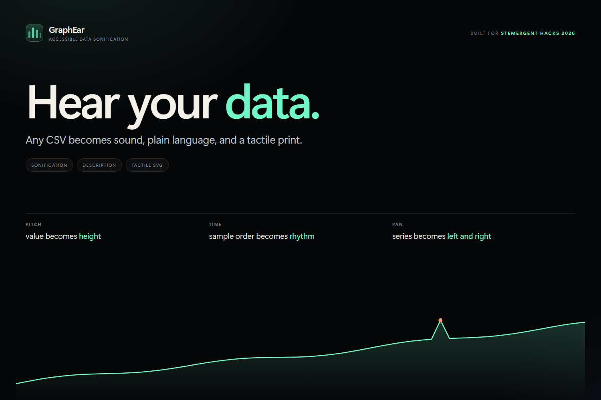

# GraphEar

**Hear the shape of your data.**

[**Live demo**](https://aryamanironman.github.io/graphear/) · [Open the app](https://aryamanironman.github.io/graphear/app.html) · [42-second film](https://aryamanironman.github.io/graphear/graphear-launch.mp4)




GraphEar turns any CSV into sound, plain language, and a tactile print, so a blind student can read a graph without seeing it.

Built for **STEMergent Hacks 2026** — Hackathon Pathway.

---

## The problem

Science lessons are full of the sentence "look at the graph." Screen readers read the numbers inside a table, but they cannot read the *shape*: the trend, the comparison between two series, the outlier that breaks the pattern. Those are exactly the parts that decide whether a student can do the physics.

Blind and low-vision students are therefore excluded from graph-heavy work, not by ability but by format. Teachers are told to make materials accessible and are given no practical tool for it.

## What GraphEar does

- **Sound.** Pitch maps to value, sample order maps to rhythm, and stereo pan separates series. Sixty-four samples become eight seconds of audio.
- **Text.** A plain-language description names the trend, the range, and the outlier, generated from the data rather than written in advance.
- **Touch.** A tactile SVG export with a raised line, labelled axes, and a marked outlier, sized for swell paper.

The same numbers drive all three, so a student can switch channels without losing the finding.

## Try it

**Live:** https://aryamanironman.github.io/graphear/

**Source:** https://github.com/Aryamanironman/graphear

Or open `app.html` in a browser. No install, no account, no server.

- Press **Space** to play or pause.
- **← / →** step through samples.
- **↑ / ↓** change speed.
- **D** regenerates the description.
- **Open a CSV** accepts a header row and a numeric column.

Web Audio requires a click or keypress before it will start; that is a browser rule, not a limitation of the app.

## How it works

| Channel | Encoding |
| --- | --- |
| Pitch | value, mapped logarithmically across the observed range |
| Time | sample order, one note per sample |
| Pan | series, so two columns separate in the stereo field |
| Text | template over trend, percentage change, range, and z-score outlier |
| Tactile | SVG line plus point markers, black on white for swell-paper printing |

Everything runs locally in the browser. No data leaves the page.

## Repo layout

```
index.html          landing page and live demo
app.html            the working product (self-contained)
screenshots/        submission stills
source/             film and soundtrack sources
```

video.html          16:9 launch film, frame-accurate via window.seek(t)
video45.html        4:5 vertical edit
render.js           Playwright frame renderer (16:9)
render45.js         Playwright frame renderer (4:5)
audio.py            synthesised soundtrack and sonification score
tts.py              voiceover generation (Microsoft neural voice)
mix.py              voice/music mix with ducking
thumb.html          submission thumbnail
out/graphear-launch.mp4   42s, 1920x1080
out/graphear-4x5.mp4      42s, 1080x1350
out/submission/     thumbnail and gallery stills
```

## Accessibility notes

GraphEar is designed keyboard-first, includes an `aria-live` readout that announces the current sample, labels every control, and respects reduced motion on the published page.

It has **not** yet been tested with a classroom of blind students or with a full NVDA/JAWS/VoiceOver pass. That is the next milestone, and the reason the project exists. Stating this plainly matters more than claiming a validation that has not happened.

## Limitations

- Accepts one numeric column per series; a two-series CSV is supported in the built-in sample but the uploader reads the first numeric column.
- CSV only; no XLSX, no remote URLs.
- Sonification length is capped at 6–18 seconds regardless of row count.
- The tactile SVG is a print-ready line, not a certified braille graph.

## Built with

HTML, CSS, JavaScript, Web Audio API, SVG, Playwright, ffmpeg, Python, Microsoft Edge neural TTS.

## Team

Aryaman Sharma.
